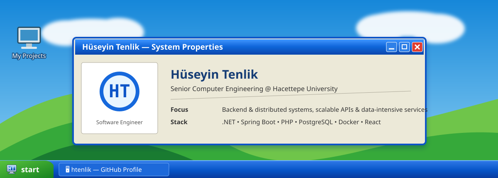
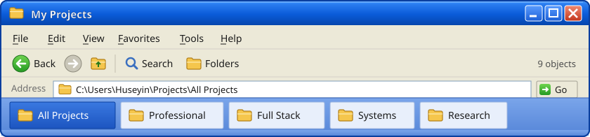
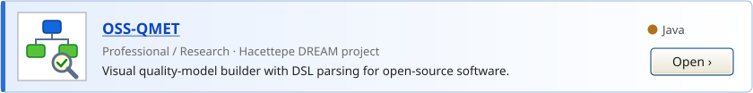
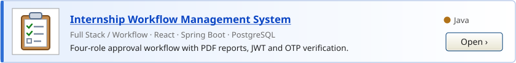
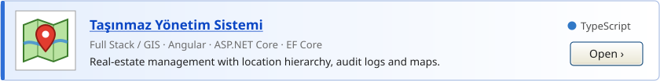
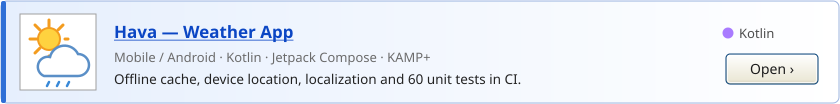
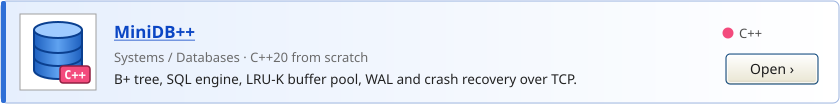
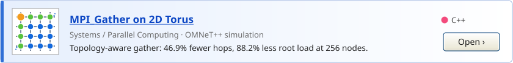
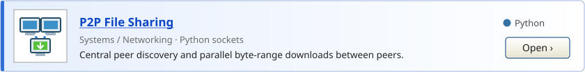
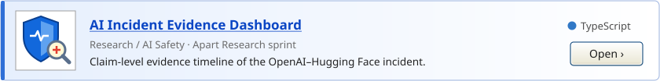

<div align="center">

[](https://htenlik.com)

<br/>

[](https://htenlik.com)
[](https://htenlik.com)
[](https://internship-workflow-management-syst.vercel.app/)
</div>

## `C:\Users\Huseyin\about.exe`

```text
Name       : Hüseyin Tenlik
Education  : Computer Engineering, Hacettepe University
Direction  : Software Engineering, Backend Developer
```

I am a computer engineering student who enjoys turning backend logic into software that people can actually open, use and evaluate.

## `C:\Projects\explorer.exe`

<div align="center">

<a href="https://htenlik.com/#projects"></a>
<a href="https://github.com/htenlik/jutform-hackathon"></a>
<a href="https://github.com/htenlik/open-source-software"></a>
<a href="https://github.com/htenlik/Internship-Workflow-Management-System"></a>
<a href="https://github.com/htenlik/Tasinmaz-Management-System"></a>
<a href="https://github.com/htenlik/weather-app"></a>
<a href="https://github.com/htenlik/minidb_cpp"></a>
<a href="https://github.com/htenlik/MPIGatherTorus"></a>
<a href="https://github.com/htenlik/P2P-File-Sharing"></a>
<a href="https://github.com/htenlik/apart-incident-dashboard"></a>
<a href="https://htenlik.com/#projects"></a>

<sub>📁 <b>Coursework</b> — <a href="https://github.com/htenlik/BBM103">BBM103</a> · <a href="https://github.com/htenlik/BBM104">BBM104</a> · <a href="https://github.com/htenlik/BBM203">BBM203</a> · <a href="https://github.com/htenlik/BBM204">BBM204</a> · <a href="https://github.com/htenlik/BBM233">BBM233</a></sub>

</div>

---

## `C:\System32\skills.dll`

<div align="center">

### Backend & Application Development


### Data, Frontend & Infrastructure


</div>

---

## `C:\Network\connect.url`

<div align="center">

**Portfolio:** [htenlik.com](https://htenlik.com)  
**GitHub:** [github.com/htenlik](https://github.com/htenlik)  

<br/>

[](https://htenlik.com)

<sub>Designed to feel like my portfolio — engineered to explain what I actually build.</sub>

</div>
